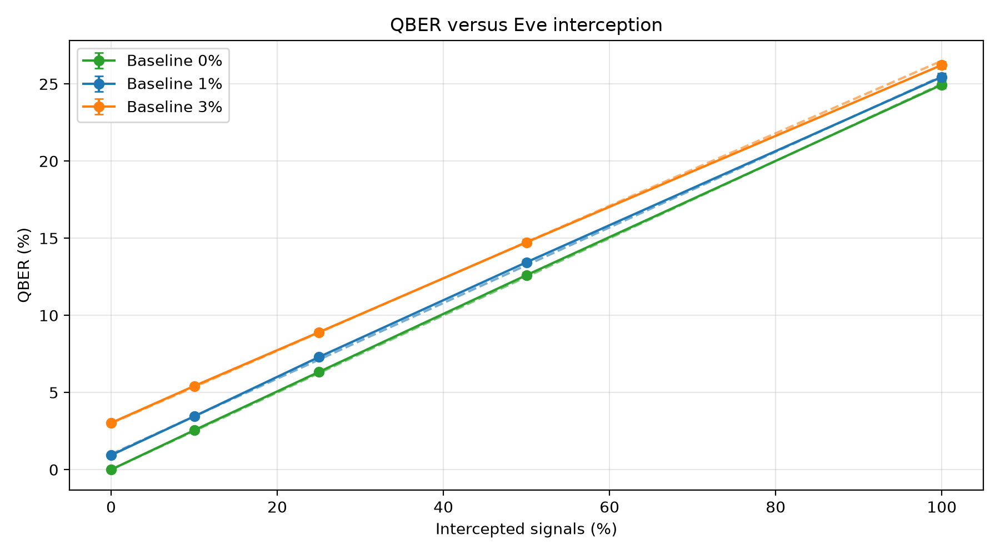
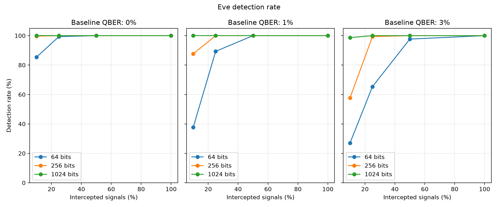
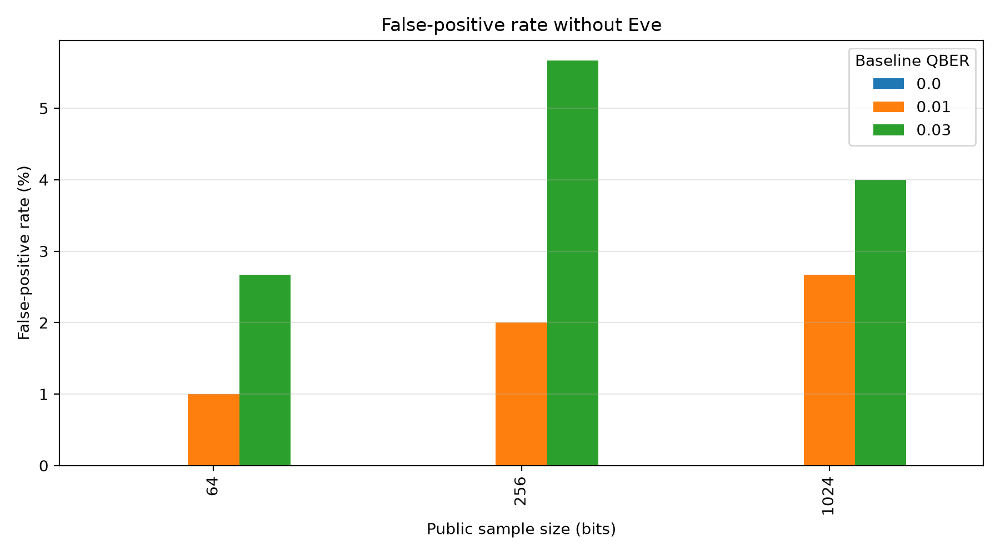
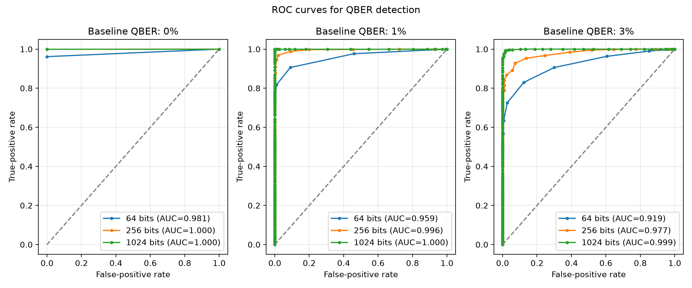

# Proyecto BB84

**Detección de interceptación parcial en BB84 bajo ruido y muestras finitas.**

Proyecto de Computación Cuántica y Criptografía, Universidad de los Andes.

## Integrantes

- Juan Francisco Rodriguez
- Daniel Alfonso Rudas Bohorquez
- Tomas Camilo Ostos

## Objetivo

Estudiar cuántos bits de muestra necesitan Alice y Bob para detectar a Eve cuando intercepta una fracción de las señales cuánticas y el canal también introduce errores normales.

El proyecto implementa BB84 mediante Qiskit Aer, incorpora un ataque *intercept-resend*, simula ruido del canal y utiliza una prueba estadística sobre el QBER para identificar errores superiores al nivel basal esperado.

## Funcionalidades implementadas

### 1. Protocolo BB84

- Generación de bits y bases aleatorias para Alice.
- Preparación de estados cuánticos en bases Z y X.
- Medición de Bob en bases aleatorias.
- Cribado de posiciones con bases coincidentes.
- Cálculo del QBER.
- Selección de muestras públicas sin reemplazo.
- Retirada de los bits revelados de la clave restante en el flujo de evaluación de sesiones.

### 2. Ataque de Eve y ruido

- Ataque *intercept-resend* con interceptación parcial.
- Fracciones de interceptación entre 0 y 1.
- Medición y retransmisión de señales por Eve.
- Ruido despolarizante del canal.
- Errores de lectura configurables.
- Semillas para reproducibilidad experimental.

### 3. Detección estadística

El detector utiliza una prueba binomial unilateral:

- **H0:** el QBER corresponde al ruido basal del canal.
- **H1:** el QBER supera el nivel esperado.

Se calcula un valor-p utilizando el número de errores de la muestra pública. El nivel de significancia es **α = 0.05**. Se declara una anomalía estadísticamente significativa cuando el valor-p es menor o igual a α.

Detectar un exceso de errores no demuestra por sí solo la presencia de Eve: también podrían existir fuentes de ruido no modeladas.

### 4. Experimentos y visualizaciones

- Calibración del ruido basal.
- Experimentos con diferentes fracciones de interceptación.
- Comparación de tamaños de muestra.
- Medición de tasas de detección y falsos positivos.
- Gráficas de QBER y curvas ROC.
- Validación complementaria con sesiones independientes.

## Instalación

El proyecto utiliza Python 3.12 y Qiskit Aer.

### Windows con PowerShell

```powershell
git clone https://github.com/Jfrc72/Proyecto-BB84.git
cd Proyecto-BB84
py -3.12 -m venv .venv
.\.venv\Scripts\python.exe -m pip install --upgrade pip
.\.venv\Scripts\python.exe -m pip install -r requirements.txt
```

### macOS o Linux

```bash
git clone https://github.com/Jfrc72/Proyecto-BB84.git
cd Proyecto-BB84
python3.12 -m venv .venv
source .venv/bin/activate
python -m pip install --upgrade pip
python -m pip install -r requirements.txt
```

En los comandos siguientes se utiliza `python`. En Windows, puede reemplazarse por `.\.venv\Scripts\python.exe`.

## Ejecución

### Demostración del protocolo ideal

```bash
python demo.py
python demo.py --senales 4096 --muestra 1024 --semilla 42
python demo.py --circuitos
python demo.py --guardar resultados/sesion_ideal.json
```

Parámetros: `--senales` (señales enviadas), `--muestra` (bits revelados), `--semilla` (reproducibilidad), `--circuitos` (mostrar circuitos) y `--guardar` (exportar JSON).

### Simulación de Eve y ruido

```bash
python demo_eve_ruido.py
```

Ejecuta escenarios ideales, ataques parciales de Eve, ruido del canal y combinaciones de ataque y ruido.

### Calibración del ruido

```bash
python calibrar_ruido.py
```

Permite estudiar el QBER basal del canal sin Eve.

### Detección estadística

```bash
python demo_deteccion.py
```

Presenta el QBER observado y basal, el número de errores, el valor-p binomial, la decisión estadística y la longitud restante de la clave.

### Experimentos del diseño original

```bash
python experimentos.py
```

El programa lee `config_experimentos.json` y utiliza:

| Parámetro | Valores |
|---|---|
| Fracción interceptada por Eve | 0 %, 10 %, 25 %, 50 %, 100 % |
| QBER basal objetivo | 0 %, 1 %, 3 % |
| Tamaño de muestra | 64, 256, 1024 bits |
| Sesiones independientes por escenario de Eve y ruido | 300 |
| Señales transmitidas por sesión | 4096 |
| Nivel de significancia | α = 0.05 |
| Semilla maestra | 2026 |

Se ejecutaron **4500 sesiones cuánticas independientes**: 15 escenarios de Eve y ruido, cada uno con 300 sesiones. En cada sesión se evaluaron tres tamaños de muestra, para un total de **13 500 evaluaciones estadísticas**, equivalentes a 300 observaciones en cada una de las 45 combinaciones.

Los tres tamaños de muestra se obtienen de una misma sesión mediante muestras aleatorias anidadas. Por ello, **las evaluaciones correspondientes a distintos tamaños dentro de una sesión están correlacionadas**; no representan 13 500 sesiones cuánticas independientes.

Los resultados se guardan en `resultados/experimentos_bb84.csv`.

### Generación de gráficas

```bash
python graficas.py
```

Genera las siguientes imágenes en `resultados/graficas/`:

- `01_qber_vs_eve.png`: QBER observado frente a fracción interceptada.
- `02_detection_rate.png`: tasa de detección por ataque, ruido y tamaño de muestra.
- `03_false_positives.png`: falsas alarmas sin Eve.
- `04_roc_curves.png`: curvas ROC y AUC.

También exporta `resultados/resumen_experimentos.csv`, con las 45 combinaciones experimentales.

### Validación complementaria anterior

```bash
python validacion_final.py
python analisis_validacion.py
```

Estos scripts corresponden a una validación complementaria previa, distinta del diseño experimental completo: Eve al 0 % y 10 %, ruido basal al 1 % y 3 %, muestras de 128, 256 y 512 bits, y 100 sesiones por escenario de Eve y ruido (400 sesiones y 1200 evaluaciones). Sus resultados **no sustituyen** el experimento principal descrito arriba.

## Resultados experimentales

### Calibración del ruido

En las pruebas previas de calibración, los niveles basales observados estuvieron próximos a los objetivos:

| QBER objetivo | QBER observado |
|---|---:|
| 0 % | 0 % |
| 1 % | 0.992 % |
| 3 % | 3.036 % |

Para los experimentos principales se utilizaron probabilidades de ruido despolarizante de 0, 0.02 y 0.06 para los tres niveles basales, respectivamente, sin ruido de lectura adicional.

### Detección de Eve al 10 %

Tasa empírica de detección en 300 sesiones por configuración:

| QBER basal objetivo | 64 bits | 256 bits | 1024 bits |
|---|---:|---:|---:|
| 0 % | 85.33 % | 99.67 % | 100 % |
| 1 % | 37.67 % | 87.67 % | 100 % |
| 3 % | 27.00 % | 57.67 % | 98.67 % |

El objetivo propuesto es una tasa de detección **≥ 90 %**. Para Eve al 10 %, se alcanza con 1024 bits en las tres condiciones de ruido, pero no en todas las muestras pequeñas.

### Falsos positivos sin Eve

Tasa empírica de falsas alarmas en 300 sesiones por configuración:

| QBER basal objetivo | 64 bits | 256 bits | 1024 bits |
|---|---:|---:|---:|
| 0 % | 0 % | 0 % | 0 % |
| 1 % | 1.00 % | 2.00 % | 2.67 % |
| 3 % | 2.67 % | 5.67 % | 4.00 % |

El objetivo propuesto es una tasa de falsas alarmas **≤ 5 %**. Ocho de las nueve configuraciones lo cumplen empíricamente; con ruido basal del 3 % y 256 bits se observó **5.67 %**. Esta diferencia se informa sin alterar los resultados. Un nivel de significancia nominal del 5 % no garantiza que cada estimación empírica con 300 sesiones sea igual o inferior al 5 %.

### QBER e interceptación

El QBER aumenta al incrementar la fracción de señales interceptadas por Eve. En el canal ideal, la interceptación del 100 % produce un QBER cercano al **25 %**, consistente con el modelo *intercept-resend*. El ruido basal eleva el QBER y dificulta distinguir ataques débiles del comportamiento normal del canal.

### Curvas ROC

Las curvas ROC se calcularon usando los valores-p del detector y agrupando las fracciones positivas de interceptación evaluadas.

| QBER basal objetivo | AUC 64 bits | AUC 256 bits | AUC 1024 bits |
|---|---:|---:|---:|
| 0 % | 0.981 | 1.000 | 1.000 |
| 1 % | 0.959 | 0.996 | 1.000 |
| 3 % | 0.919 | 0.977 | 0.999 |

Las AUC aumentan en general con el tamaño de muestra. Estos valores describen la discriminación en los escenarios simulados, no en todos los ataques posibles.

### Gráficas del experimento principal









## Interpretación de resultados

El experimento evidencia que la interceptación de Eve incrementa el QBER y que el aumento del tamaño de muestra mejora la capacidad de detección. En presencia de ruido basal, detectar ataques débiles requiere muestras mayores.

El objetivo de detección del 90 % **no se cumple para todas las configuraciones**, especialmente con 64 bits y ruido. Para una interceptación del 10 %, sí se supera con muestras de 1024 bits en los tres canales. El objetivo de falsas alarmas del 5 % se cumple empíricamente en ocho de nueve configuraciones; la restante alcanza 5.67 %.

Estos resultados describen el desempeño del detector bajo los supuestos del modelo simulado. No constituyen una garantía de seguridad criptográfica ni prueban que cualquier incremento del QBER provenga necesariamente de Eve.

## Pruebas automatizadas

```bash
python -m unittest discover -s tests -v
python -m pip check
```

Se implementaron 33 pruebas automatizadas: 13 del protocolo BB84, 10 de Eve y ruido y 10 del detector estadístico. La última ejecución reportó **33 pruebas exitosas**.

## Organización

```text
Proyecto-BB84/
├── bb84.py
├── demo.py
├── eve_ruido.py
├── demo_eve_ruido.py
├── calibrar_ruido.py
├── deteccion_qber.py
├── demo_deteccion.py
├── experimentos.py
├── graficas.py
├── validacion_final.py
├── analisis_validacion.py
├── config_experimentos.json
├── requirements.txt
├── README.md
├── docs/
│   └── INTEGRACION.md
├── tests/
│   ├── test_bb84.py
│   ├── test_eve_ruido.py
│   └── test_deteccion_qber.py
└── resultados/
    ├── experimentos_bb84.csv
    ├── resumen_experimentos.csv
    ├── validacion_final.csv          # Complementario, si se genera
    ├── resumen_validacion.csv        # Complementario, si se genera
    └── graficas/
        ├── 01_qber_vs_eve.png
        ├── 02_detection_rate.png
        ├── 03_false_positives.png
        └── 04_roc_curves.png
```

La carpeta `resultados/` está excluida de Git por `.gitignore` de forma predeterminada. Los **dos CSV del experimento principal y sus cuatro gráficas** deben añadirse explícitamente al repositorio para que las imágenes del README y la evidencia experimental sean accesibles desde GitHub. Los resultados complementarios pueden regenerarse con sus scripts.

## Experimentos acordados en la propuesta

El archivo `config_experimentos.json` define:

- Interceptación: 0, 0.10, 0.25, 0.50 y 1.00.
- Canal ideal y QBER basal objetivo cercano al 1 % y 3 %.
- Muestras de 64, 256 y 1024 bits.
- Al menos 300 sesiones independientes por escenario.
- Objetivo de detección ≥ 90 % y falsas alarmas ≤ 5 %.

**La matriz experimental se ejecutó íntegramente:** 4500 sesiones cuánticas independientes y 13 500 evaluaciones estadísticas en 45 combinaciones. Los tamaños de muestra de una misma sesión están correlacionados; existen 300 sesiones independientes por cada escenario de Eve y ruido, no 300 sesiones distintas para cada tamaño de muestra.

Los objetivos de desempeño son criterios de evaluación, no resultados garantizados. Las configuraciones que no los alcanzan se reportan expresamente.

## Supuestos y limitaciones

El simulador utiliza señales independientes y un qubit por señal, con un canal clásico autenticado para el anuncio de bases.

Las semillas permiten reproducir los experimentos, pero no representan un mecanismo criptográfico seguro para generar claves reales.

No se implementan reconciliación de errores ni amplificación de privacidad. El detector presupone un nivel de ruido basal conocido; en una implementación real, ese nivel debe estimarse independientemente y considerar su incertidumbre.

Los bits revelados públicamente deben excluirse de cualquier clave criptográfica final. En el experimento de evaluación se analizan muestras públicas sobre claves cribadas simuladas; no se genera ni utiliza una clave criptográfica final.

Los resultados dependen del modelo de ruido, del ataque simulado y de las condiciones evaluadas. No constituyen una demostración general de seguridad de BB84.

## Referencias

- [Bennett y Brassard, BB84 (1984), reimpresión](https://arxiv.org/abs/2003.06557).
- [Qiskit: QuantumCircuit](https://quantum.cloud.ibm.com/docs/en/api/qiskit/qiskit.circuit.QuantumCircuit).
- [Qiskit Aer: simuladores](https://qiskit.github.io/qiskit-aer/tutorials/1_aersimulator.html).
- [Qiskit Aer: modelos de ruido](https://qiskit.github.io/qiskit-aer/tutorials/3_building_noise_models.html).
